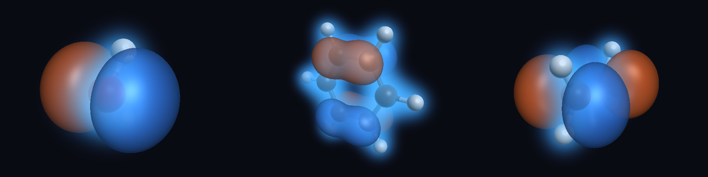

# Quantum Molecules

Real quantum chemistry for molecules and pieces of crystals in the browser. Pick a molecule (or paste an XYZ file),
choose Hartree–Fock, LDA or PBE and a basis set, and see the electron density as a volumetric cloud
with molecular orbitals as isosurfaces. Drag an atom and the SCF re-runs as you move it; press
**Relax** and the geometry optimizes in front of you.



## What it computes

| | |
|---|---|
| Methods | RHF, UHF (open shells), restricted Kohn–Sham DFT with LDA (Slater + VWN5) and PBE |
| Basis sets | STO-3G, 6-31G, 6-31G\* (cartesian d), elements H–Ar |
| Properties | total energy, orbital energies, HOMO–LUMO gap, dipole moment, analytic nuclear gradients |
| Geometry | BFGS optimization with analytic gradients, warm-started SCF between steps |
| Presets | H₂, H₂O, NH₃, CH₄, HF, N₂, CO₂, CH₂O, C₂H₄, C₆H₆, OH radical, triplet O₂; glycine, pyridine, aspirin, glucose; pieces of diamond, silicon, graphite, NaCl and MgO |

Everything is checked against [PySCF](https://pyscf.org) (see `scripts/gen_reference.py`): energies
agree to 1e-8 Ha for Hartree–Fock and 2e-5 Ha for DFT, gradients to 1e-6 and 1e-4 Ha/bohr. The larger
presets and the crystal pieces match PySCF's RHF/STO-3G energies to 1e-6 Ha (`tests/chem.test.ts`).

## Crystals

The engine solves finite molecules; it has no periodic boundary conditions. A crystal preset therefore
cuts a cluster out of the experimental lattice (`src/chem/crystals.ts`) and computes that, with the
atoms on their lattice sites:

| Preset | Cluster | Basis functions (STO-3G) |
|---|---|---|
| Diamond | C₁₀H₁₆, the adamantane cage at the centre of the cubic cell | 66 |
| Silicon | Si₁₀H₁₆, the same cage in silicon | 106 |
| Graphite | C₁₆H₁₀, a pyrene-shaped flake of one sheet | 90 |
| Table salt | Na₄Cl₄, one small cube of the rock-salt lattice | 72 |
| Magnesium oxide | Mg₄O₄ | 56 |

Bonds cut in covalent crystals end in hydrogen atoms along the bond direction (C–H 1.09 Å,
Si–H 1.48 Å), the standard way to stop dangling bonds from dominating a small cluster. The ionic
clusters need no caps. The rest of the crystal and the unit cells are drawn see-through around the
cluster, with a slider for how many cells to show; the UI says plainly that they are not part of the
calculation.

## How it works

```
crates/qchem        Rust library: integrals, SCF, DFT grids and functionals, gradients, BFGS
crates/qchem-wasm   wasm-bindgen bindings (Session, Optimizer)
src/engine          Web Worker hosting the WASM engine, and the client the UI talks to
src/render          WebGPU: compute shader for the density/orbital volume, ray marcher, atoms
src/ui, src/main.ts Controls, orbital level diagram, readouts, dragging
```

- **Quantum chemistry runs in Rust, compiled to WebAssembly**, in f64. Integrals use the
  McMurchie–Davidson scheme with Schwarz screening; the SCF starts from a superposition of atomic
  densities and uses DIIS. DFT uses Becke-partitioned Mura–Knowles/Lebedev grids. The library has no
  browser dependencies, so it can back other simulators or run natively
  (`cargo run --release --example water`).
- **The GPU does the volumes.** WGSL has no f64, but rendering does not need it: after each SCF the
  worker sends the basis and orbital coefficients, and a compute shader evaluates the density and
  the selected orbital on a ~112³ grid into an `rgba16float` 3D texture. A full-screen pass
  ray-marches it (emission/absorption for the cloud, sign-change detection for the ± isosurfaces)
  and stops at the depth of the ball-and-stick atoms.
- **The integrals run on every core.** Without shared memory (GitHub Pages cannot send the headers
  WebAssembly threads need) the engine worker hands out stripes of the two-electron integrals, and of
  the two-electron part of the forces, to a pool of WASM workers and assembles the results; the
  numbers are identical to a single-threaded run. Molecules with fewer than 8 atoms stay on one
  thread. `?threads=1` turns the pool off.
- **SCF playback** records the orbitals of every iteration, so the cloud can be replayed from the
  atomic guess to convergence without recomputing.

Timings for one Hartree–Fock SCF at STO-3G with the release WASM build, on one core in Node and
with the integrals spread over 8 workers:

| | 1 core | 8 workers |
|---|---|---|
| diamond piece, C₁₀H₁₆ | 3.3 s | 0.65 s |
| table salt, Na₄Cl₄ | 2.1 s | 0.65 s |
| silicon piece, Si₁₀H₁₆ | 8.7 s | 2.3 s |

(The 8-worker column adds the slowest stripe to the rest of the SCF.)

DFT time is dominated by the integration grid, which is the next thing to move to the GPU.

## Running it

Needs Rust with the `wasm32-unknown-unknown` target, [wasm-pack](https://rustwasm.github.io/wasm-pack/)
and Node 20+.

```sh
npm install
npm run build:wasm   # compiles crates/qchem-wasm into crates/qchem-wasm/pkg
npm run dev          # http://localhost:5173
```

The 3D view needs WebGPU (recent Chrome, Edge or Safari). Without it the calculations still run and
the readouts work. `?res=64` lowers the volume resolution for slow GPUs.

## Tests

```sh
cargo test --release   # Rust: integrals, all methods vs PySCF, finite-difference gradients, invariances
npm test               # Vitest: the WASM build vs PySCF, worker protocol, presets, orbital evaluation
npm run test:e2e       # Playwright: the app in headless Chromium (WebGPU on SwiftShader)
```

The browser tests open the app with `?headless`, which renders offscreen because headless Chromium
cannot present a WebGPU canvas. They read the GPU volume back and compare it point by point with
the CPU evaluation, and exercise presets, method switching, dragging, relaxing and SCF playback.

To regenerate the PySCF reference data: `pip install pyscf && python scripts/gen_reference.py`.

## Not yet

Periodic boundary conditions (real crystals rather than clusters), open-shell DFT, molecular
dynamics, GPU two-electron integrals for larger molecules, density differences and electrostatic
potential maps.
